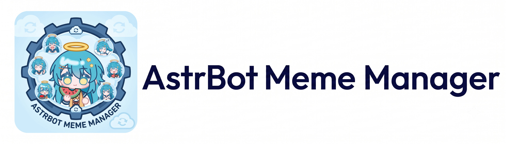
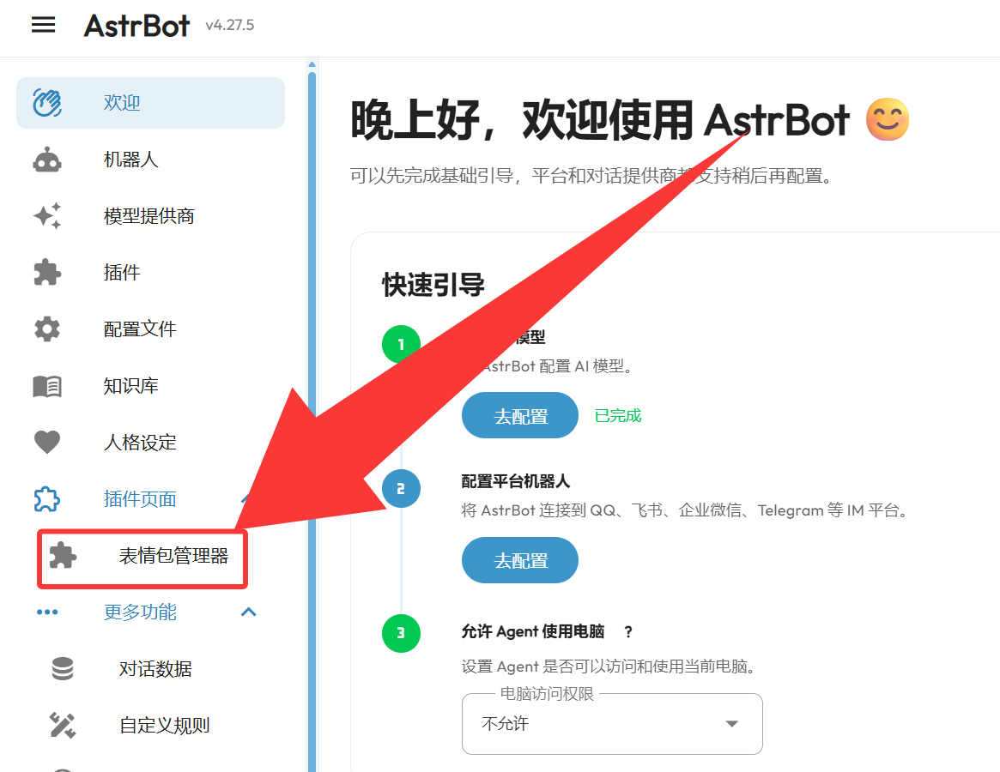
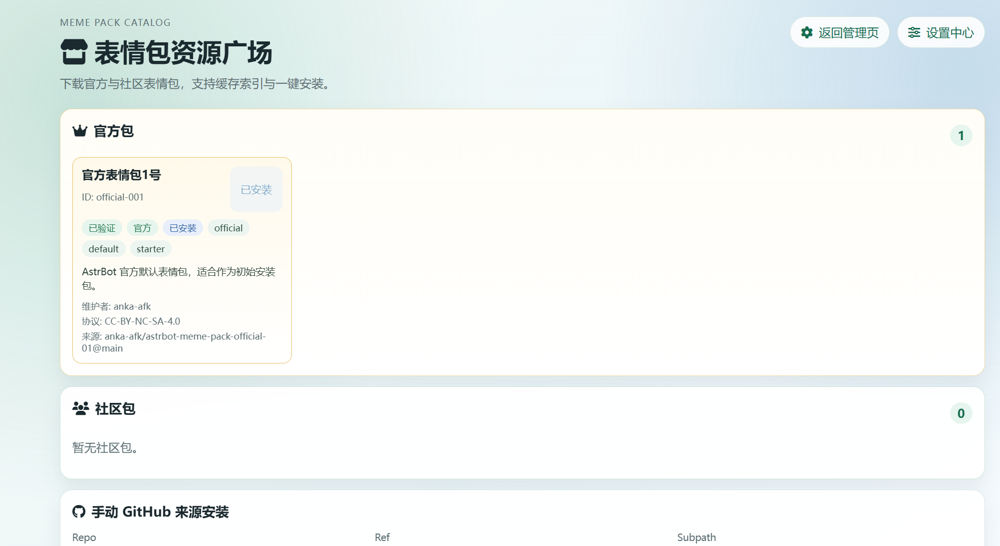
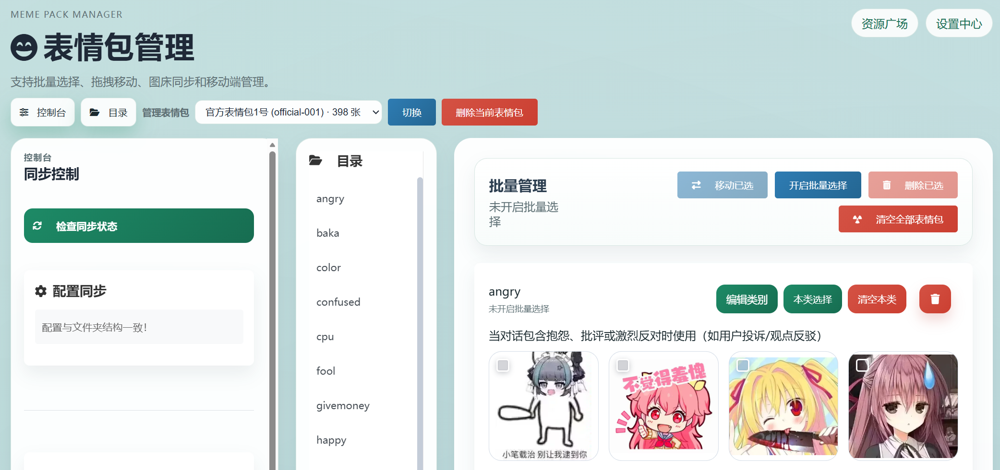
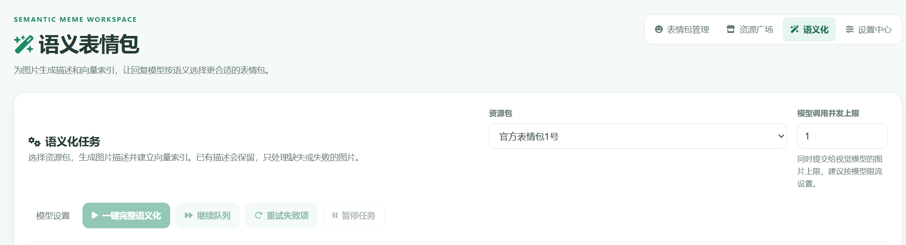

# 🌟 AstrBot 表情包管理器

为 AstrBot 提供表情包下载、整理、智能发送与自动收集功能。通过 WebUI 管理多个表情包，按会话或人格组合使用，并支持分类选图、语义检索和云端同步。

## 📑 目录

- [📢 通知](#-通知)
- [🛠️ 第一次使用](#️-第一次使用)
- [❓ 常见问题](#-常见问题)
- [☁️ 支持的图床](#️-支持的图床)
- [📚 协议与创作指引](#-协议与创作指引)
- [🖥️ WebUI 管理界面](#️-webui-管理界面)
- [🤖 自动收集表情包](#-自动收集表情包)
- [⚠️ 兼容性](#️-兼容性)
- [📝 使用指令](#-使用指令)
- [📜 更新日志](#-更新日志)
- [🛠️ 问题反馈](#️-问题反馈)
- [📄 许可证](#-许可证)

## 📢 通知

旧版本升级说明：v5.0.1 提示词模板

**v5.0.1 提供新版提示词，请按需重置默认模板。** 升级并重载插件后，进入 **设置中心 → 提示词模板 → 恢复默认模板 → 保存并应用**，载入新版前缀、后缀及附加模板。已有自定义内容请先复制备份，再按需合并回新版模板。

## 🛠️ 第一次使用

1. 安装插件后，进入 AstrBot WebUI → 插件页面 → **表情包管理器**。
2. 打开**资源广场**，下载一个官方或社区表情包；也可以使用 `/表情管理 恢复默认表情包` 安装官方包。
3. 进入**设置中心 → 使用规则**，将下载的包设为默认，或绑定到指定会话、人格，然后保存规则。同一规则可多选表情包；桌面端按住 Ctrl / Command 点击，先选的包优先。
4. 开始聊天。插件会自动提供当前表情包的分类提示，无需修改人格；有合适的表情时，模型可以配合文字发送，也可以只发表情。

首次使用没有内置图片，需要先安装表情包。管理页的选包用于浏览和编辑，聊天实际使用哪个包由使用规则决定。

## ❓ 常见问题

**必须配置图床吗？** 不需要。图床用于云端同步，本地管理与表情发送可独立使用。

**下载了新包，为什么聊天还用原来的？** 请在设置中心保存使用规则。下载或切换管理页的表情包，不会自动修改聊天选包规则。

**可以流式回复吗？** 可以。经过 AstrBot 流式消息管线的标签会在发送前解析，有歧义的片段会暂时缓冲，图片在回复结束后发送。

**必须进行语义化吗？** 不需要。普通分类模式即可使用；希望按图片描述检索时，再配置语义化。

## ☁️ 支持的图床

图床仅用于云端同步，可在**设置中心 → 存储与下载**中选择并配置：

- 兰空图床（Lsky Pro 开源版 2.x）
- Cloudflare R2
- WebDAV
- StarDots

## 📚 协议与创作指引

### 协议文档

- 协议文档见 [anka-afk/astrbot-meme-pack-index](https://github.com/anka-afk/astrbot-meme-pack-index)

### 如何创建并分享自己的表情包（Issue / PR）

1. 前往索引仓库 README 阅读完整提交指引：
   [anka-afk/astrbot-meme-pack-index](https://github.com/anka-afk/astrbot-meme-pack-index)
2. 按协议准备你的表情包仓库结构（manifest、memes、previews），并确保仓库可访问。
3. 如果你会编辑索引文件：
   - 直接在索引仓库提交 PR
4. 如果你不会编辑索引文件：
   - 在索引仓库提 Issue，按模板填写信息
5. 你也可以先参考示例仓库模板：
   [anka-afk/astrbot-meme-pack-example](https://github.com/anka-afk/astrbot-meme-pack-example)

> 建议：先在本地或测试环境通过“资源广场安装”验证一次，确保索引条目可安装、可预览、分类描述清晰。

## 🖥️ WebUI 管理界面

### 资源广场

浏览和安装官方、社区表情包，也支持通过 GitHub 仓库地址安装索引之外的表情包。

已安装的资源包有新版时，可在**可更新**栏目查看。更新前按分类逐张预览新增、修改和删除的图片，自选要纳入的内容，再选择更新方式：

- **合并更新，保留本地修改**：优先保留自己整理过的内容。
- **合并更新，保留上游更改**：优先采用资源包作者的更新，保留本地独有内容。
- **只添加新内容**：补充新表情，不修改或删除已有图片。
- **完整替换**：按确认的内容替换当前包，操作前需确认可能丢弃本地修改。

查看资源包更新预览

### 表情包管理

按分类预览图片，上传、删除、拖拽移动或批量整理表情，编辑分类描述，并切换不同表情包进行管理。

桌面端可拖拽移动图片，触屏端可长按进入多选，再批量操作。移动既支持包内分类整理，也支持**移动到其他表情包**；跨包移动时可保留原分类或指定目标分类，同名分类描述不一致时会提示手动选择，确认后再移动。

切换到任意已安装的表情包即可直接在该包内上传、删除、拖拽移动、批量整理和编辑分类，修改不会落到其他包。新建表情包时可以填写**自定义包 ID**（留空自动生成），ID 只能包含小写字母、数字、点、下划线和短横线，重复 ID 会被拒绝。

图片预览加载与浏览器缓存

页面预览默认同时加载 2 张图片，可在 AstrBot 插件配置的「页面预览」或插件设置中心的「存储与下载 → 页面预览」调整为 1–8 张，保存后刷新页面生效。并发限制按每个打开的插件页面计算。

已浏览的图片会使用浏览器私有缓存，文件未变化时重新进入页面可减少重复下载。替换文件后重新加载图库会使用新的图片版本；浏览器清理缓存或强制刷新时可能重新下载。此功能控制加载并发和重复流量，不限制服务器总带宽。

### 语义表情包

普通模式按分类选择表情；语义模式会先为图片生成描述和检索向量，再根据对话寻找更贴切的图片。使用前需在设置中心配置图片描述模型与向量模型，并在“语义化”页面完成处理。生成描述和向量会调用对应模型，费用取决于所用服务。

语义化页面可以查看处理进度、继续任务和重试失败图片。启用人工审核时，自动收集的图片先在表情包管理页审核接收；关闭审核时，新图片自动入包。启用语义检索后，“自动收集后生成向量”默认开启，入包后后台增量生成向量并复用已有索引。该设置仅在语义检索启用时显示；关闭后可在管理页点击“增量处理”。待分类或描述未完成的图片需先在语义化页面处理，不影响已有有效向量的检索。详见[向量更新说明](docs/zh/semantic-index.md)。

### 设置中心

在**模式**页选择原生分类、辅助模型分类或两种语义检索模式，再沿流程图查看使用规则、选图、回退与发送设置。点击流程中的配置项可在弹窗内修改；也可以从**使用规则、表情发送、自动收集、存储与下载、提示词模板、标签与匹配、导入与备份**等分类进入。配置修改后点击“保存并应用”，使用规则单独保存。

**导入与备份**里的压缩包导入采用分片上传，导入大体积表情包时不会因为面板单次上传上限而失败；导入前会先校验包结构与兼容性，确认后再写入。

| 模式 | 如何选图 | 使用前准备 | 适合的用法 |
| --- | --- | --- | --- |
| 原生分类标签 | 回复模型输出分类标签，再从该分类随机取图 | 安装表情包，无需额外选图模型或语义索引 | 先体验分类选图，配置较少 |
| 辅助模型分类标签 | 辅助模型根据回复选择分类，再从分类随机取图 | 选图会额外调用辅助模型，默认复用当前对话的回复模型 | 希望由辅助模型负责分类选择 |
| Tool 语义检索 | 回复模型调用搜索工具，从候选中选择具体图片 | 回复模型支持 Tool 调用；完成图片描述与向量索引 | 希望回复模型主动检索、选择更贴切的图片 |
| 辅助模型语义检索 | 辅助模型根据回复检索并选图 | 完成图片描述与向量索引；选图额外调用辅助模型 | 希望回复模型专注对话，由辅助模型负责选图 |

两种语义模式均需配置图片描述模型与向量模型。语义数据或索引未就绪时，会回退到对应的分类标签方式；Tool 不可用时回退到原生分类标签。

查看流程图中的配置入口示例

**使用规则支持多包混用**：同一默认、会话或人格规则可同时选择多个表情包。例如，日常聊天混用几个常用包，为指定会话或人格另设一组组合。桌面端按住 Ctrl / Command 多选，先选的包优先；规则从上到下匹配，未匹配时使用默认规则。管理页切换表情包只影响浏览和整理，不改变聊天使用规则。

## 🤖 自动收集表情包

在**设置中心 → 自动收集**开启，并选择支持图片输入的视觉模型。插件会识别收到的图片，从目标表情包的现有分类中选择合适的分类，并进行去重。

平台明确标记为表情的图片按配置抽样识别；普通图片或缺少平台分类的图片首次仅记录，重复出现后逐步提高识别概率。

采样概率、重复计数与识别间隔

普通图片或缺少平台分类的图片第二次出现时有 45% 的识别采样概率，之后逐次提高，第八次必定触发。同一发送者在不同消息中重复发送也会计数；连续 7 天未出现的记录会过期。单条消息最多处理的图片数可设置为 1–10 张，默认 1 张；同一来源最短识别间隔限制的是不同消息的入队时间，不影响重复次数记录。

自动收集默认关闭，识图需要调用视觉模型。开启后默认启用人工审核，可在管理页统一处理候选图片：

1. 进入**表情包管理**，切换到收集目标包。
2. 有待审核图片时，选包框右侧显示**待审核表情**按钮，点击查看图片、建议分类和两项置信度。
3. 默认按分类置信度从高到低排列，低把握度排在后面；可筛选分类、调整排序和修改接收分类，然后接收选中的图片。
4. 不需要的图片可以丢弃；勾选“不再收集”后，相同内容不会再次进入该包的候选列表。

关闭人工审核后，新收集的图片自动入包，已有待审核图片仍需处理。启用语义检索后，默认在入包时自动增量生成向量；可在“自动收集 → 审核与入包”关闭“自动收集后生成向量”，改用管理页的“增量处理”。符合当前语义描述标准且接收分类未改变的收集结果可直接复用描述。

## ⚠️ 兼容性

需要 **AstrBot 4.17.0 或更新版本**。

其他插件自行请求模型或发送消息时，可通过本插件的公开接口接入表情处理。接口说明与示例见 [开发指南 → 插件联动接口](DEVELOPMENT.md#插件联动接口)，流式处理方式与边界见 [解析与消息发送](DEVELOPMENT.md#解析与消息发送)。

## 📝 使用指令

当前大部分功能都可以通过 AstrBot WebUI 管理界面操作，无需使用指令。以下为指令列表，供 CLI 用户参考：

| 指令                                   | 描述                                                |
| -------------------------------------- | --------------------------------------------------- |
| `/表情管理 查看图库`                   | 📚 列出所有可用表情类别                             |
| `/表情管理 添加分类 [类别名称] [描述]` | ➕ 创建新的表情包分类，可只输入名称后按提示补充描述 |
| `/表情管理 添加表情 [类别]`            | ➕ 通过聊天上传表情到指定类别                       |
| `/表情管理 恢复默认表情包`             | ♻️ 从官方仓库一键安装首个官方表情包并设为默认       |
| `/表情管理 清空指定类型 [类别]`        | ⚠️ 清空指定类别中的表情包，保留类型本身             |
| `/表情管理 清空全部`                   | ⚠️ 清空全部表情包，保留所有类型和描述配置           |
| `/表情管理 删除类型本身 [类别]`        | ⚠️ 删除指定类型及其描述配置                         |
| `/表情管理 同步状态`                   | 🔄 检查同步状态                                     |
| `/表情管理 同步到云端`                 | ☁️ 将本地表情同步到云端                             |
| `/表情管理 从云端同步`                 | ⬇️ 从云端同步表情到本地                             |
| `/表情管理 覆盖到云端`                 | ⚠️ 让云端与本地完全一致                             |
| `/表情管理 从云端覆盖`                 | ⚠️ 让本地与云端完全一致                             |

> `/表情管理 添加表情` 的上传目标以当前会话使用规则解析的主表情包为准，与管理页当前浏览的图包无关；多包绑定时仅写主包。执行命令后请在 30 秒内发送图片；处理结果会分别报告新增、重复和失败数量。

## 📜 更新日志

当前版本：v5.2.5

- 修复自动收集入包后，描述和向量已完成但页面仍显示“语义待更新”的问题，同步快照计数与后台状态刷新（[#161](https://github.com/anka-afk/astrbot_plugin_meme_manager/issues/161)）。旧图包的异常快照可通过一次增量更新校正。
- 修复聊天上传无法读取 QQ 官方接入的本地图片，以及全部失败仍提示成功的问题；支持框架图片转换、内容校验、同分类去重和准确的成功失败提示（[#162](https://github.com/anka-afk/astrbot_plugin_meme_manager/issues/162)）。
- 聊天上传统一写入当前会话主图包，防止重名覆盖，并保护切包和任务取消时的文件、语义元数据一致性。
- 升级后请重载插件并刷新管理页面。1046 项后端测试、85 个子测试及 62 项前端测试通过。

完整版本记录请查看 [CHANGELOG.md](CHANGELOG.md)。

## 🛠️ 问题反馈

如果遇到问题或有功能建议，欢迎在 GitHub 提交 Issue。

## 📄 许可证

本项目基于 MIT 许可证开源。
