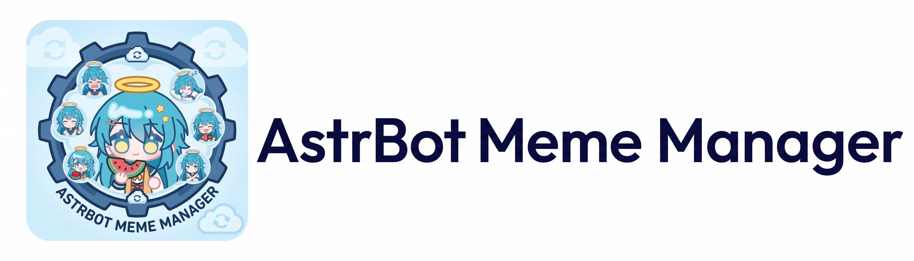
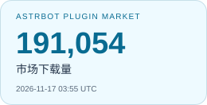
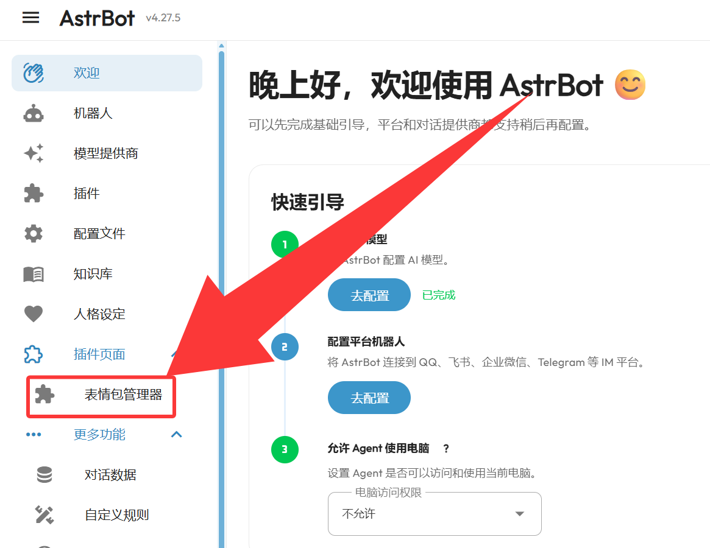
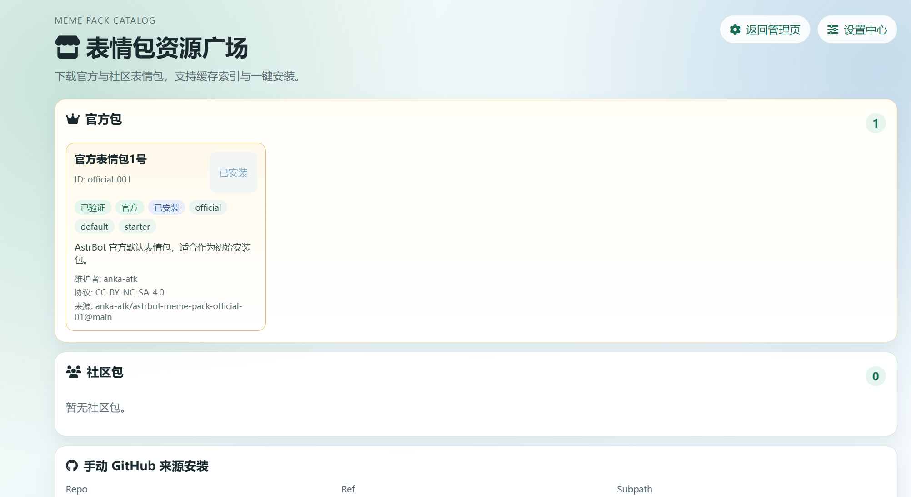
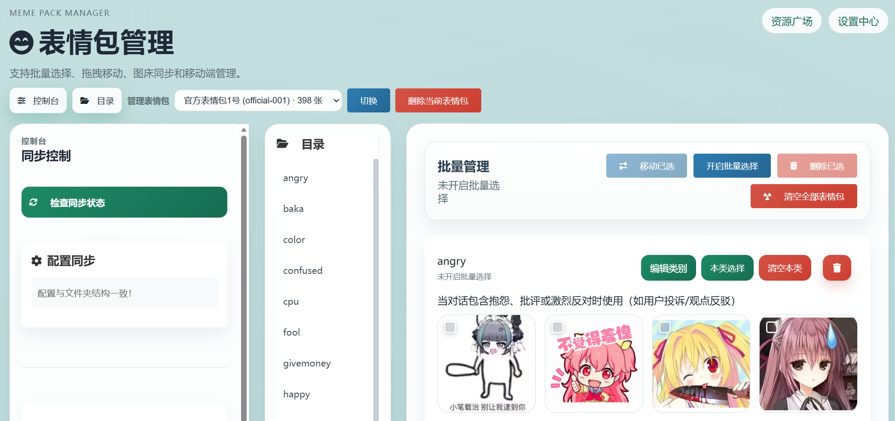
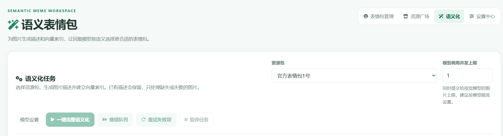
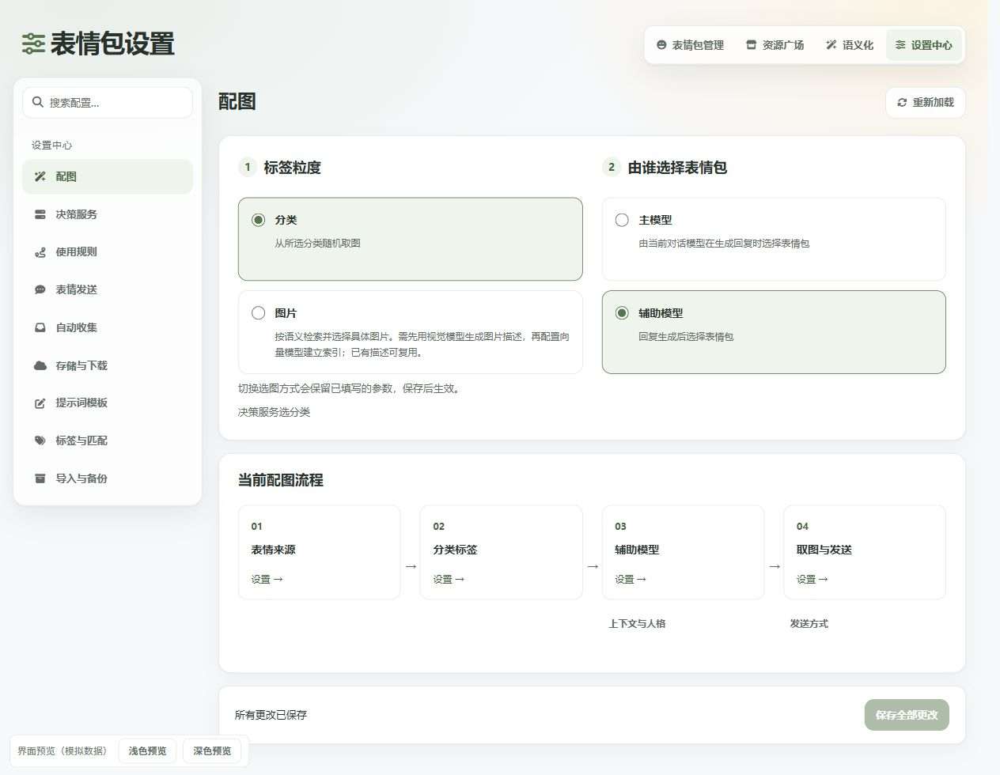
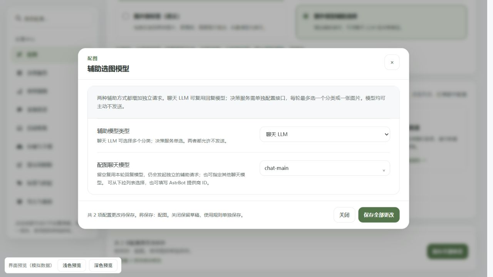
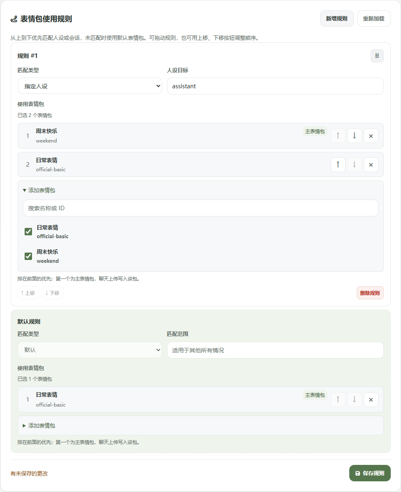

# 🌟 AstrBot 表情包管理器

  <a href="https://ankaanka.org/astrbot_plugin_meme_manager/"><strong>浏览表情包资源广场 →</strong></a>

  
  
  

为 AstrBot 提供表情包下载、整理、智能发送与自动收集功能。通过 WebUI 管理多个表情包，按会话或人格组合使用，并支持分类选图、语义检索和云端同步。

## ✨ 能做什么

| 你想做的事           | 表情包管理器如何帮你                                                     |
| -------------------- | ------------------------------------------------------------------------ |
| 先让 Bot 用上表情    | 从资源广场安装表情包，设置使用规则，即可开始使用；无需额外选图模型或图床 |
| 为不同聊天搭配表情   | 按默认、会话或人格绑定多个包，自由组合；无需修改人格提示词               |
| 找到更贴合语境的图片 | 分类级或图片级标签，交给主模型自选或额外模型辅助；按需准备语义索引     |
| 整理越来越大的图库   | WebUI 分类预览、拖拽整理、批量操作、跨包移动，资源包更新前逐图查看差异   |
| 留下聊天里的好表情   | 自动识别、分类、去重，支持人工审核后入包与增量生成向量                   |
| 备份和分享自己的收藏 | 支持多种图床同步，也能按开放协议制作、发布社区表情包                     |

> **第一次用？** 先安装一个表情包、保存使用规则，就能体验默认的“分类级标签 · 主模型自选”，无需额外的选图模型调用。语义选图和自动收集可按需开启，相关模型调用费用取决于所用服务。

## 📑 目录

- [📢 通知](#-通知)
- [🛠️ 第一次使用](#️-第一次使用)
- [❓ 常见问题](#-常见问题)
- [☁️ 支持的图床](#️-支持的图床)
- [📚 协议与创作指引](#-协议与创作指引)
- [🖥️ WebUI 管理界面](#️-webui-管理界面)
- [🤖 自动收集表情包](#-自动收集表情包)
- [⚠️ 兼容性](#️-兼容性)
- [📝 使用指令](#-使用指令)
- [📜 更新日志](#-更新日志)
- [✨ Star](#star)
- [📄 许可证](#-许可证)

## 📢 通知

> [!IMPORTANT]
> **升级 AstrBot 前，建议先将本插件更新至 v5.2.9 或更新版本。**
>
> 旧版插件可能与 AstrBot Desktop 的核心依赖锁冲突，导致安装失败。请先更新插件，按提示完成依赖安装并重载，再升级 AstrBot。
>
> 已有 R2 配置和桶内图片无需迁移，也无需手动降级 AstrBot 的核心依赖。

旧版本升级说明：v5.0.1 提示词模板

**v5.0.1 提供新版提示词，请按需重置默认模板。** 升级并重载插件后，进入 **设置中心 → 提示词模板 → 恢复默认模板 → 保存并应用**，载入新版前缀、后缀及附加模板。已有自定义内容请先复制备份，再按需合并回新版模板。

## 🛠️ 第一次使用

在 AstrBot 插件市场搜索 **表情包管理器** 安装

1. 安装插件后，进入 AstrBot WebUI → 插件页面 → **表情包管理器**。
2. 打开**资源广场**，下载一个官方或社区表情包。
3. 进入**设置中心 → 使用规则**，将下载的包设为默认，或绑定到指定会话、人格，然后保存规则。同一规则可多选表情包：展开“添加表情包”，按名称或 ID 搜索并勾选；在已选列表中上移、下移或移除，第一项为主表情包。
4. 开始聊天。插件会自动提供当前表情包的分类提示，无需修改人格；有合适的表情时，模型可以配合文字发送，也可以只发表情。

首次使用没有内置图片，需要先安装表情包。管理页的选包用于浏览和编辑，聊天实际使用哪个包由使用规则决定。

## ❓ 常见问题

**必须配置图床吗？** 不需要。图床用于云端同步，本地管理与表情发送可独立使用。

**下载了新包，为什么聊天还用原来的？** 请在设置中心保存使用规则。下载或切换管理页的表情包，不会自动修改聊天选包规则。

**可以流式回复吗？** 可以。经过 AstrBot 流式消息管线的标签会在发送前解析，有歧义的片段会暂时缓冲，图片在回复结束后发送。

**必须进行语义化吗？** 不需要。“按分类取图”即可使用；希望按图片描述检索时，再配置语义化。

## ☁️ 支持的图床

图床仅用于云端同步，可在**设置中心 → 存储与下载**中选择并配置：

- 兰空图床（Lsky Pro 开源版 2.x）
- Cloudflare R2
- WebDAV
- StarDots

Cloudflare R2 使用 MinIO Python SDK 接入 S3 API，不依赖 `boto3` / `botocore`，避免其 `python-dateutil<3` 限制与桌面端依赖锁冲突。已有账户 ID、访问密钥、存储桶、路径前缀和公开访问地址配置继续使用，无需迁移桶内图片。

## 📚 协议与创作指引

### 协议文档

- 协议文档见 [anka-afk/astrbot-meme-pack-index](https://github.com/anka-afk/astrbot-meme-pack-index)

### 如何创建并分享自己的表情包（Issue / PR）

1. 前往索引仓库 README 阅读完整提交指引：
   [anka-afk/astrbot-meme-pack-index](https://github.com/anka-afk/astrbot-meme-pack-index)
2. 按协议准备你的表情包仓库结构（manifest、memes、previews），并确保仓库可访问。
3. 如果你会编辑索引文件：
   - 直接在索引仓库提交 PR
4. 如果你不会编辑索引文件：
   - 在索引仓库提 Issue，按模板填写信息
5. 你也可以先参考示例仓库模板：
   [anka-afk/astrbot-meme-pack-example](https://github.com/anka-afk/astrbot-meme-pack-example)

> 建议：先在本地或测试环境通过“资源广场安装”验证一次，确保索引条目可安装、可预览、分类描述清晰。

## 🖥️ WebUI 管理界面

### 资源广场

浏览和安装官方、社区表情包，也支持通过 GitHub 仓库地址安装索引之外的表情包。

已安装的资源包有新版时，可在**可更新**栏目查看。

查看资源包更新预览

### 表情包管理

按分类预览图片，上传、删除、拖拽移动或批量整理表情，编辑分类描述，并切换不同表情包进行管理。

桌面端可拖拽移动图片，触屏端可长按进入多选，再批量操作。

切换到任意已安装的表情包即可直接在该包内上传、删除、拖拽移动、批量整理和编辑分类，修改不会落到其他包。新建表情包时可以填写**自定义包 ID**（留空自动生成），ID 只能包含小写字母、数字、点、下划线和短横线，重复 ID 会被拒绝。

### 语义表情包

普通模式按分类选择表情；语义模式会先为图片生成描述和检索向量，再根据对话寻找更贴切的图片。使用前需在设置中心配置图片描述模型与向量模型，并在“语义化”页面完成处理。生成描述和向量会调用对应模型，费用取决于所用服务。

语义化页面可以查看处理进度、继续任务和重试失败图片。自动收集的审核与向量设置见下文；待分类或描述未完成的图片需先在语义化页面处理，不影响已有有效向量的检索。

### 设置中心

在**模式**页（原“配图”）选择标签粒度与选择者，点击流程节点配置，再**保存全部更改**；使用规则单独保存。语义化页“模型设置”直达数据准备，旧链接继续有效。

**导入与备份**里的压缩包导入采用分片上传，导入大体积表情包时不会因为面板单次上传上限而失败；导入前会先校验包结构与兼容性，确认后再写入。

| 标签粒度 | 由谁选择 | 原模式名称 |
| --- | --- | --- |
| 分类级（随机取图） | 主模型 | 原生分类标签 |
| 分类级（随机取图） | 额外辅助 | 辅助模型分类标签 |
| 图片级（语义检索） | 主模型 | Tool 语义检索 |
| 图片级（语义检索） | 额外辅助 | 辅助模型语义检索 |

旧配置保持原行为。图片级标签需先生成描述与向量索引；索引未就绪时回退对应分类方式，Tool 不可用时回退主模型分类自选。无候选、主动弃选或运行失败时不补发。

已知图片 ID 时，主模型可在当前会话绑定的表情包中直接引用该图片，跳过本轮语义检索。短 ID 须能唯一匹配一个图片条目。同一条目存在于多个绑定包时，直接引用会按绑定顺序选一个有效副本，本轮检索返回的 ID 则沿用候选来源。

额外辅助支持聊天模型或决策服务，均增加请求。聊天模型留空跟随主模型；决策服务支持 [System One](https://docs.system-one.dev/zh-CN/docs/api) 和 Cloudflare Workers AI 的 `clef` 系列，配置后可点「测试连接」（消耗少量额度，不保存设置）。账户 ID 与密钥留空保留，点「清除」才移除。单选或不发送，失败保留文字。语义检索默认由聊天模型生成检索词，也可直接使用回复文本。

**发送概率与工具调用**

- **表情发送概率**仅控制自动配图：0% 不自动附图，100% 也不保证每轮发送。完全停用发图还需关闭 **启用主动发送表情工具**。
- **主动发送工具**默认开启，模型可通过 `send_meme` 按分类或搜索结果发图，不受自动配图概率和数量上限限制。开启 **仅通过工具发送表情** 后，支持工具调用的模型将只通过该工具发图。
- 有可用语义索引时，模型可按需调用 `search_memes` 搜索并发送候选图片；支持图片输入的模型还可用 `preview_memes` 预览分类原图，再按编号发送。预览每页默认 9 张，可在设置中调整或关闭。
- 在「图片级标签（语义）＋主模型自行选择」中可开启 **Tool 概率触发** 并设置检索概率，默认关闭。它与自动发送概率相互独立，开启后可能增加一次主模型请求。

查看流程图中的配置入口示例

**使用规则支持多包混用**：同一默认、会话或人格规则可同时选择多个表情包。例如，日常聊天混用几个常用包，为指定会话或人格另设一组组合。通过“添加表情包”搜索并勾选，无需按住 Ctrl / Command；已选列表支持上移、下移和移除，越靠前越优先，第一项为主表情包，聊天上传写入该包。规则从上到下匹配，未匹配时使用默认规则。管理页切换表情包只影响浏览和整理，不改变聊天使用规则。

## 🤖 自动收集表情包

- **手动收集**：管理员可引用或附图发送 `/表情管理 收集表情`；连续整理使用“开始收集／结束收集”。无需开启自动收集，结束后已提交的图片仍会继续处理。
- **自动收集**：默认关闭。在**设置中心 → 自动收集**中开启并选择视觉模型后，插件会识别、去重并分类聊天图片，也可按需启用内容规则筛选。普通图片采用抽样识别，减少模型调用。
- **审核入包**：默认启用人工审核，可在**表情包管理 → 待审核表情**修改分类、接收或丢弃候选图片；关闭后，合格图片自动入包，低置信度或识别失败的仍需复核。启用语义选图时，默认自动生成向量。

## ⚠️ 兼容性

需要 **AstrBot 4.28.2 或更新版本**，以及 **Python 3.12 或更新版本**。更新插件前，请先确认 AstrBot 及其实际运行的 Python 环境满足要求。

部分微信 4.x 接入中，JPG/PNG 可能显示为普通图片而非表情气泡，可尝试开启**设置中心 → 表情发送 → 静态图转 GIF 发送**。该选项默认关闭，仅在发送时转换，不修改图库原文件；其他平台通常无需开启。

AstrBot 内置 `send_message_to_user` 自动支持表情标记和辅助选图，沿用权限、自动配图概率与整轮数量限制。跨会话按目标人格选包，同一目标不重复补图。

其他插件自行请求模型或发送消息时，可通过本插件的公开接口接入表情处理。接口说明与示例见 [开发指南 → 插件联动接口](DEVELOPMENT.md#插件联动接口)，流式处理方式与边界见 [解析与消息发送](DEVELOPMENT.md#解析与消息发送)。

## 📝 使用指令

当前大部分功能都可以通过 AstrBot WebUI 管理界面操作，无需使用指令。以下为指令列表，供 CLI 用户参考：

| 指令                                   | 描述                                                |
| -------------------------------------- | --------------------------------------------------- |
| `/表情管理 查看图库`                   | 📚 列出所有可用表情类别                             |
| `/表情管理 添加分类 [类别名称] [描述]` | ➕ 创建新的表情包分类，可只输入名称后按提示补充描述 |
| `/表情管理 添加表情 [类别]`            | ➕ 通过聊天上传表情到指定类别                       |
| `/表情管理 收集表情`                  | 引用消息或附图，识别分类并按审核设置收录           |
| `/表情管理 开始收集`                  | 连续接收自己在当前聊天发送的图片                   |
| `/表情管理 结束收集`                  | 停止接收新图片并汇总，已提交任务继续处理           |
| `/表情管理 恢复默认表情包`             | ♻️ 从官方仓库一键安装首个官方表情包并设为默认       |
| `/表情管理 清空指定类型 [类别]`        | ⚠️ 清空指定类别中的表情包，保留类型本身             |
| `/表情管理 清空全部`                   | ⚠️ 清空全部表情包，保留所有类型和描述配置           |
| `/表情管理 删除类型本身 [类别]`        | ⚠️ 删除指定类型及其描述配置                         |
| `/表情管理 同步状态`                   | 🔄 检查同步状态                                     |
| `/表情管理 同步到云端`                 | ☁️ 将本地表情同步到云端                             |
| `/表情管理 从云端同步`                 | ⬇️ 从云端同步表情到本地                             |
| `/表情管理 覆盖到云端`                 | ⚠️ 让云端与本地完全一致                             |
| `/表情管理 从云端覆盖`                 | ⚠️ 让本地与云端完全一致                             |

## 📜 更新日志

当前版本：v5.4.3

- 适配 AstrBot 4.30.0-beta.1 的内置消息发送工具、带图请求的备用模型选择和会话人格选包。
- 继续支持 AstrBot 4.28.2 及以上版本。新版已实测管理页预览和 WebChat 发图。

升级后请重载插件。

完整版本记录请查看 [CHANGELOG.md](CHANGELOG.md)。

## ✨ Star

感谢每一位使用、反馈、分享表情包和贡献代码的朋友。如果这个插件对你有帮助，欢迎点一个 Star。

分享，让你我走到了今天。

## 📄 许可证

本项目基于 MIT 许可证开源。
