

# 🌟 AstrBot 表情包管理器

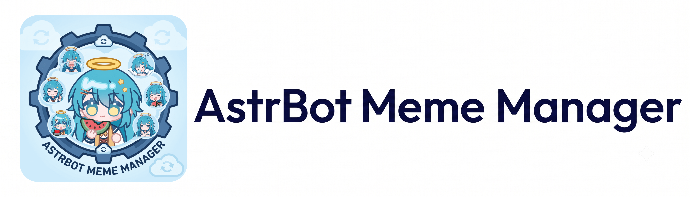

  
  
  

为 AstrBot 提供表情包下载、整理、智能发送与自动收集功能。通过 WebUI 管理多个表情包，按会话或人格组合使用，并支持分类选图、语义检索和云端同步。

## ✨ 能做什么

| 你想做的事           | 表情包管理器如何帮你                                                     |
| -------------------- | ------------------------------------------------------------------------ |
| 先让 Bot 用上表情    | 从资源广场安装表情包，设置使用规则，即可开始使用；无需额外选图模型或图床 |
| 为不同聊天搭配表情   | 按默认、会话或人格绑定多个包，自由组合；无需修改人格提示词               |
| 找到更贴合语境的图片 | 分类级或图片级标签，交给主模型自选或额外模型辅助；按需准备语义索引     |
| 整理越来越大的图库   | WebUI 分类预览、拖拽整理、批量操作、跨包移动，资源包更新前逐图查看差异   |
| 留下聊天里的好表情   | 自动识别、分类、去重，支持人工审核后入包与增量生成向量                   |
| 备份和分享自己的收藏 | 支持多种图床同步，也能按开放协议制作、发布社区表情包                     |

> **第一次用？** 先安装一个表情包、保存使用规则，就能体验默认的“分类级标签 · 主模型自选”，无需额外的选图模型调用。语义选图和自动收集可按需开启，相关模型调用费用取决于所用服务。

## 📑 目录

- [📢 通知](#-通知)
- [🛠️ 第一次使用](#️-第一次使用)
- [❓ 常见问题](#-常见问题)
- [☁️ 支持的图床](#️-支持的图床)
- [📚 协议与创作指引](#-协议与创作指引)
- [🖥️ WebUI 管理界面](#️-webui-管理界面)
- [🤖 自动收集表情包](#-自动收集表情包)
- [⚠️ 兼容性](#️-兼容性)
- [📝 使用指令](#-使用指令)
- [📜 更新日志](#-更新日志)
- [✨ Star](#star)
- [📄 许可证](#-许可证)

## 📢 通知

> [!IMPORTANT] > **升级 AstrBot 前，建议先将本插件更新至 v5.2.9 或更新版本。**
>
> 旧版插件可能与 AstrBot Desktop 的核心依赖锁冲突，导致安装失败。请先更新插件，按提示完成依赖安装并重载，再升级 AstrBot。
>
> 已有 R2 配置和桶内图片无需迁移，也无需手动降级 AstrBot 的核心依赖。

旧版本升级说明：v5.0.1 提示词模板

**v5.0.1 提供新版提示词，请按需重置默认模板。** 升级并重载插件后，进入 **设置中心 → 提示词模板 → 恢复默认模板 → 保存并应用**，载入新版前缀、后缀及附加模板。已有自定义内容请先复制备份，再按需合并回新版模板。

## 🛠️ 第一次使用

在 AstrBot 插件市场搜索 **表情包管理器** 安装

1. 安装插件后，进入 AstrBot WebUI → 插件页面 → **表情包管理器**。
2. 打开**资源广场**，下载一个官方或社区表情包。
3. 进入**设置中心 → 使用规则**，将下载的包设为默认，或绑定到指定会话、人格，然后保存规则。同一规则可多选表情包：展开“添加表情包”，按名称或 ID 搜索并勾选；在已选列表中上移、下移或移除，第一项为主表情包。
4. 开始聊天。插件会自动提供当前表情包的分类提示，无需修改人格；有合适的表情时，模型可以配合文字发送，也可以只发表情。

首次使用没有内置图片，需要先安装表情包。管理页的选包用于浏览和编辑，聊天实际使用哪个包由使用规则决定。

## ❓ 常见问题

**必须配置图床吗？** 不需要。图床用于云端同步，本地管理与表情发送可独立使用。

**下载了新包，为什么聊天还用原来的？** 请在设置中心保存使用规则。下载或切换管理页的表情包，不会自动修改聊天选包规则。

**可以流式回复吗？** 可以。经过 AstrBot 流式消息管线的标签会在发送前解析，有歧义的片段会暂时缓冲，图片在回复结束后发送。

**必须进行语义化吗？** 不需要。“按分类取图”即可使用；希望按图片描述检索时，再配置语义化。

## ☁️ 支持的图床

图床仅用于云端同步，可在**设置中心 → 存储与下载**中选择并配置：

- 兰空图床（Lsky Pro 开源版 2.x）
- Cloudflare R2
- WebDAV
- StarDots

Cloudflare R2 使用 MinIO Python SDK 接入 S3 API，不依赖 `boto3` / `botocore`，避免其 `python-dateutil<3` 限制与桌面端依赖锁冲突。已有账户 ID、访问密钥、存储桶、路径前缀和公开访问地址配置继续使用，无需迁移桶内图片。

## 📚 协议与创作指引

### 协议文档

- 协议文档见 [anka-afk/astrbot-meme-pack-index](https://github.com/anka-afk/astrbot-meme-pack-index)

### 如何创建并分享自己的表情包（Issue / PR）

1. 前往索引仓库 README 阅读完整提交指引：
   [anka-afk/astrbot-meme-pack-index](https://github.com/anka-afk/astrbot-meme-pack-index)
2. 按协议准备你的表情包仓库结构（manifest、memes、previews），并确保仓库可访问。
3. 如果你会编辑索引文件：
   - 直接在索引仓库提交 PR
4. 如果你不会编辑索引文件：
   - 在索引仓库提 Issue，按模板填写信息
5. 你也可以先参考示例仓库模板：
   [anka-afk/astrbot-meme-pack-example](https://github.com/anka-afk/astrbot-meme-pack-example)

> 建议：先在本地或测试环境通过“资源广场安装”验证一次，确保索引条目可安装、可预览、分类描述清晰。

## 🖥️ WebUI 管理界面

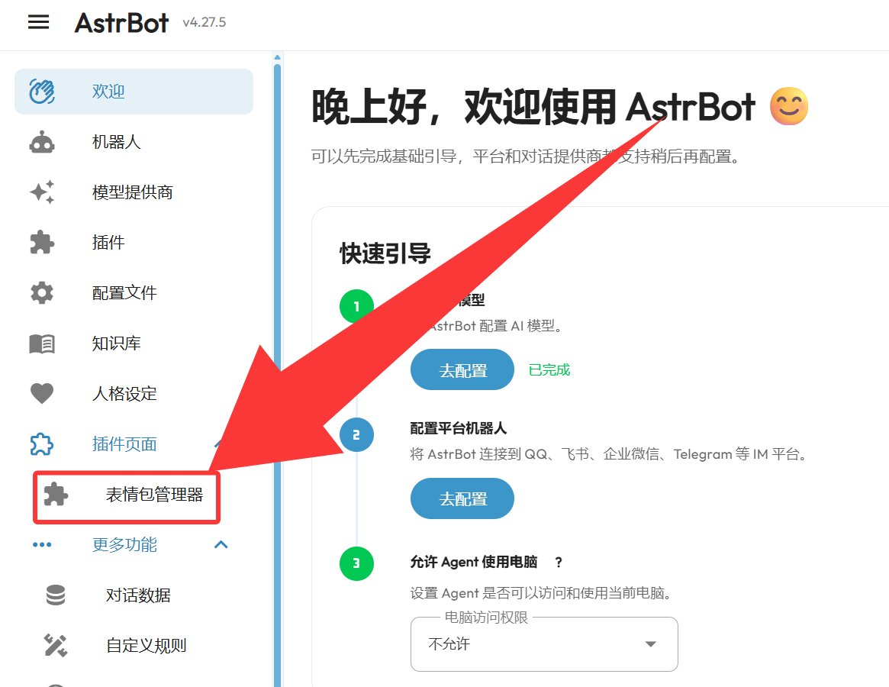

### 资源广场

浏览和安装官方、社区表情包，也支持通过 GitHub 仓库地址安装索引之外的表情包。

已安装的资源包有新版时，可在**可更新**栏目查看。

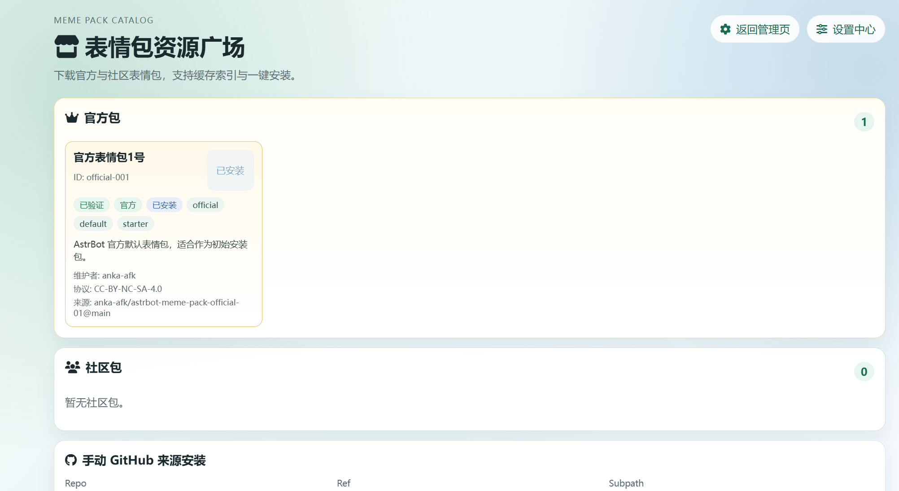

查看资源包更新预览

### 表情包管理

按分类预览图片，上传、删除、拖拽移动或批量整理表情，编辑分类描述，并切换不同表情包进行管理。

桌面端可拖拽移动图片，触屏端可长按进入多选，再批量操作。

切换到任意已安装的表情包即可直接在该包内上传、删除、拖拽移动、批量整理和编辑分类，修改不会落到其他包。新建表情包时可以填写**自定义包 ID**（留空自动生成），ID 只能包含小写字母、数字、点、下划线和短横线，重复 ID 会被拒绝。

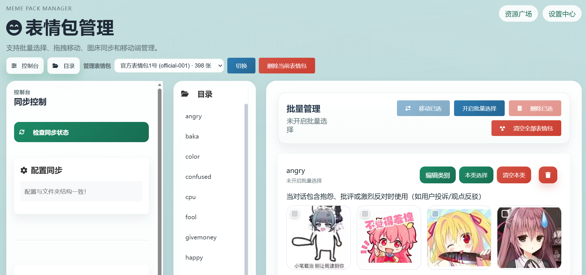

### 语义表情包

普通模式按分类选择表情；语义模式会先为图片生成描述和检索向量，再根据对话寻找更贴切的图片。使用前需在设置中心配置图片描述模型与向量模型，并在“语义化”页面完成处理。生成描述和向量会调用对应模型，费用取决于所用服务。

语义化页面可以查看处理进度、继续任务和重试失败图片。启用人工确认入包时，自动收集的图片先在管理页审核；关闭后，符合条件的新图片可自动入包，决策路径的不确定或失败结果仍强制复核。“自动收集后生成向量”在自动收集设置中始终可见，但仅在开启语义选图后生效；关闭该开关后可在管理页点击“增量处理”。待分类或描述未完成的图片需先在语义化页面处理，不影响已有有效向量的检索。

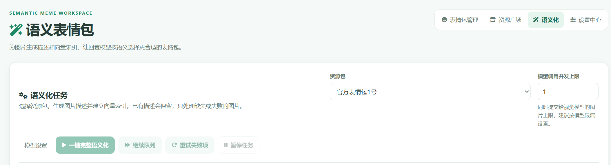

### 设置中心

在**配图**页先选择**标签粒度**（分类级／图片级语义标签），再选择**由谁选择表情包**（主模型自行选择／额外模型辅助选择）。“主模型”指当前对话中实际生成回复的模型，原界面称为“回复模型”。分类级标签选中分类后随机取图，准备简单但匹配较粗；图片级标签按语义检索并选择具体图片，需先用视觉模型生成图片描述，再配置向量模型建立索引，已有描述可复用。

下方保留**流程图式设置**：表情来源 → 标签候选 → 模型选择 → 取图与发送。点击节点统一弹窗配置，关闭后回到原流程，未保存的内容继续保留。弹窗复用各分区的同一组设置控件，不需要反复跳转页面。自动收集同样按来源与频率 → 图片理解与判断 → 审核与入包配置。只有额外辅助才显示辅助模型入口，可使用聊天 LLM 或独立决策服务；复用主模型仍会增加一次辅助请求。检索词来源、工具调用策略及数据准备也从对应节点进入。

**决策服务**是固定的侧栏入口，直接配置 System One 地址、密钥与模型 ID，再到配图或自动收集选择使用它。配图页的模型参数从流程节点配置，调用说明显示在选择区域；配图与自动收集的待补充项目直接显示在各自流程下方并可定位字段，语义准备提醒保持可见。先保存模型设置，再从“准备图片标签”前往语义化处理图包。执行与回退规则折叠在流程图底部。

语义化页的“模型设置”可直接打开「设置中心 → 配图 → 语义数据准备」弹窗。即使尚未启用图片级语义标签，也能先填写模型，跳转不会自动切换配图组合。设置页支持 `#config-group-semantic-models` 等卡片深链，加载完成后打开对应弹窗；原 `#models`、`#storage`、`#rules` 分区链接继续有效。

查看模型设置直达参数的示例

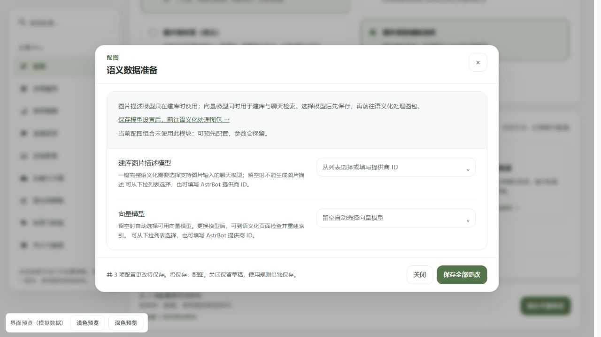

底部的**保存全部更改**会统一提交所有分区的插件配置，保存前可展开检查涉及的分区和字段；密钥只显示替换或清除状态。**使用规则仍单独保存**。保存冲突会保留草稿；已保存但应用失败时会明确提示，不能当作已经生效。

**导入与备份**里的压缩包导入采用分片上传，导入大体积表情包时不会因为面板单次上传上限而失败；导入前会先校验包结构与兼容性，确认后再写入。

| 标签粒度       | 由谁选择     | 如何选图                                         | 原模式名称       |
| -------------- | ------------ | ------------------------------------------------ | ---------------- |
| 分类级         | 主模型     | 主模型输出分类标签，从分类中随机取图           | 原生分类标签     |
| 分类级         | 额外模型辅助 | 辅助模型根据已生成的回复选择分类，再随机取图     | 辅助模型分类标签 |
| 图片级（语义） | 主模型     | 主模型调用搜索工具，从候选中选择具体图片       | Tool 语义检索    |
| 图片级（语义） | 额外模型辅助 | 根据已生成的回复检索候选，由辅助模型选择具体图片 | 辅助模型语义检索 |

旧“选图方式／选择时机”现改为“标签粒度／由谁选择表情包”；“回复时”对应主模型自行选择，“回复后”对应额外模型辅助。旧配置值保持不变，升级不会自动启用决策模型或增加请求。辅助步骤在内容生成完成后执行；流式图片仍等消息流正常完成并由平台发送后补发。

两种图片级标签组合都需要可用向量模型及有效索引；自行生成图片描述时还需要建库图片描述模型，该模型不会参与每轮聊天选图。请求准备时没有可用语义索引，会保留选择者并回退分类级标签；主模型的 Tool 不可用时回退分类级自选。无候选、模型主动不发送或运行失败不会再调用另一套选图流程补发。

**配图模型与检索词**

- 聊天模型：从输入框右侧的列表选择 AstrBot 已配置的 Provider，也可直接填写提供商 ID；留空精确跟随当前回复 Provider 和模型，保留分类多选能力。这里填写的是 AstrBot 提供商 ID，并非上游服务的任意模型名称。
- 决策模型：当前支持 [System One](https://docs.system-one.dev/zh-CN/docs/api)。在侧栏的“决策服务”中填写基础地址，点击模型旁的“获取列表”，再从输入框右侧选择，也可随时手填准确模型 ID。获取失败或列表为空不会覆盖原值；切换服务地址后需重新获取列表。首版每次选择一个分类或图片，也可以主动不发送；不会通过重复调用模拟多选。模型类型不会增加新的配图模式。
- 图片级标签与额外辅助组合，可直接使用回复文本检索，或先让聊天模型生成短检索词。旧配置默认继续生成检索词。显式指定检索词 Provider 时使用该 Provider 默认模型；留空时，聊天配图后端跟随配图聊天模型，决策配图后端跟随本轮回复聊天模型。
- 分类候选只包含实际有图的分类。候选选择同时判断贴合程度、用户是否要求配图及近期重复；硬性数量上限和发送概率继续由代码执行。决策服务失败时保留文字回复，跳过本轮配图。

共享决策服务只保存一份配置，聊天配图和自动收集分别选择是否使用。打开设置页和保存配置不会发起收费推理。决策请求不自动重试；真实费用取决于模型、完整输入和问题数量，不能仅根据输出 token 数判断。近期发送参考只在内存中按会话有界保存，记录成功发送的图片，重载后重新积累。

“获取列表”只读取当前填写地址的公开 `GET /models` 目录，无需先保存、填写密钥或模型 ID，不会自动选中模型。System One 的该接口无需密钥且不消耗推理积分，见[官方接口说明](https://docs.system-one.dev/en/docs/api)。列举明确不支持 Choice 的模型时会跳过该项；手填 ID 始终保留。列表可用不代表推理鉴权或模型调用已经验证。

**发送概率与 Tool 调用策略**

「表情发送 → 出现时机」中的 **表情发送概率**（原「表情出现概率」）适用于所有自动配图组合，且只控制本轮自动附图资格。0% 不自动附图；100% 允许自动配图，但不强迫检索或出图。通过标记生成的纯表情回复也遵守该门控。配图模型请求和工具检索仍按各自流程执行。

同一位置的 **启用主动发送表情工具** 默认开启（`generation.emotion.send_tool_enabled=true`）。开启后，向支持工具调用且拥有 AstrBot 工具权限的主模型提供 `send_meme(target)`，由模型决定何时调用。`target` 为分类键时，从当前会话绑定的图包中随机发送一张该分类图片；为本轮 `search_memes` 返回的完整 `meme:...` 候选 ID 时，立即发送对应的具体图片。依据工具返回结果确认是否发送成功，不需模型填写会话、文件路径或图片地址。

语义模式使用“`search_memes(query)` 检索 → 主模型选择候选 → `send_meme(target=候选ID)` 发送”的流程，已有候选时可直接发送。检索保留原有每轮一次和 Tool 概率策略，主动发送本身仍不受自动配图概率限制。额外辅助语义模式也可向主模型保留已授权的搜索工具，供主动选图使用；不绕过 AstrBot 工具权限。未提供搜索工具或索引不可用时，保留按分类主动发送的能力。无效、过期、跨会话或已移出绑定图包的候选会返回失败，不会随机换图发送。

工具提示会要求：用户明确请求发表情时使用工具，平时也可根据对话需要主动使用；同一轮标签与工具二选一，已经使用发送标签就不再调用工具，调用工具后也不再输出发送标签。

主动发送独立于自动配图：即使自动发送概率为 0% 或数量上限为 0，工具仍能发送；模型也可多次调用。工具遵守应用范围和当前图包绑定，调用后本轮不再额外自动配图，发送失败也不会自动补发。关闭该开关后，主模型不再获得或执行此工具。默认开启会向有工具权限的主模型增加一个可用动作；若希望完全停用图片发送，请同时关闭此开关并将自动发送概率设为 0%。

选择「图片级标签（语义）＋主模型自行选择」，点击流程中的「工具调用策略」，可用独立滑动开关启用 **Tool 概率触发**：

- 默认关闭，保留原有模型自主调用行为，升级旧配置不会自动增加前置请求。
- 开启后显示 **工具调用概率**，初始值为 100%。命中就用本轮回复 Provider 和 model 尝试一次 `search_memes`；未命中时本轮不提供或执行该工具，其他工具照常可用。0% 不检索，100% 每轮尝试，不要求额外辅助模型。
- 此策略可能增加一次当前主模型的前置请求。检索结果交给正常回复流程，仍由主模型从真实候选中决定是否选图。接口不支持强制调用、参数错误、检索失败或没有合适候选时，跳过表情并记录原因，正常文字回复继续；不额外重试或切换模式补发。
- 两个概率互相独立。例如自动发送 0%、检索调用 100% 仍会尝试检索，但不会自动附图，独立的主动发送工具仍可使用。一次用户消息触发的完整回复每个门控只判定一次；工具循环、流式输出、重试和多张候选复用该结果，自动配图的数量上限继续生效。

对应配置为 `generation.emotion.probability`、`semantic.tool_probability_enabled`（默认 `false`）和 `semantic.tool_call_probability`（默认 `100`），概率范围均为 0–100。

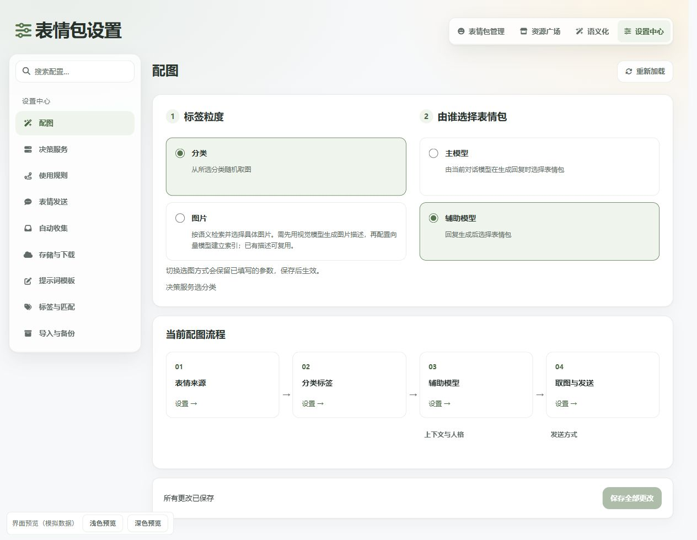

查看从流程节点弹窗配置的示例

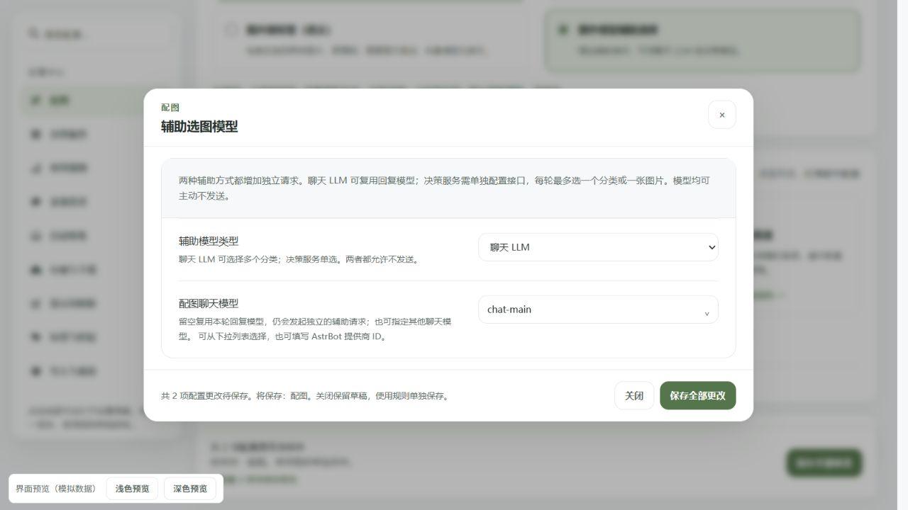

查看独立决策服务配置

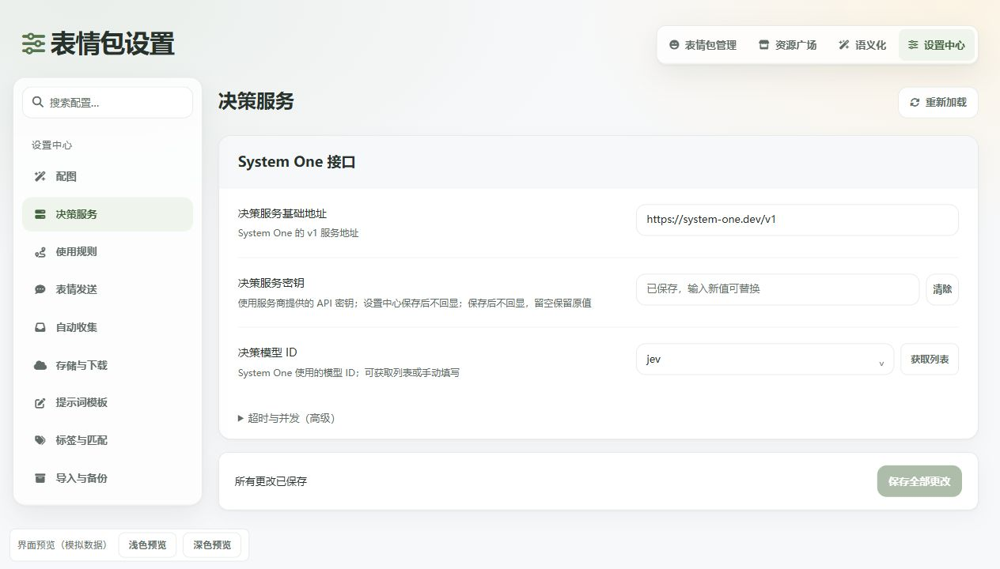

**使用规则支持多包混用**：同一默认、会话或人格规则可同时选择多个表情包。例如，日常聊天混用几个常用包，为指定会话或人格另设一组组合。通过“添加表情包”搜索并勾选，无需按住 Ctrl / Command；已选列表支持上移、下移和移除，越靠前越优先，第一项为主表情包，聊天上传写入该包。规则从上到下匹配，未匹配时使用默认规则。管理页切换表情包只影响浏览和整理，不改变聊天使用规则。

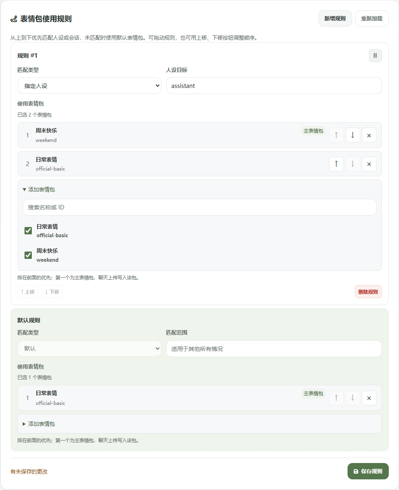

## 🤖 自动收集表情包

在**设置中心 → 自动收集**的流程中，点击“来源与频率”开启，再点击“图片理解与判断”选择支持图片输入的视觉模型。插件会识别收到的图片，从目标表情包的现有分类中选择合适的分类，并进行去重。

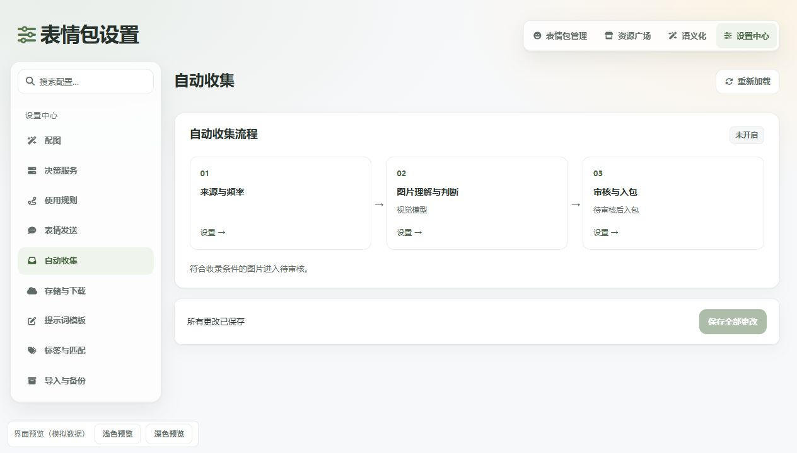

自动收集的图片理解、收录判断和分类独立于聊天配图设置。默认仍由视觉模型在一次请求中完成；可选决策后端先让视觉模型生成图片描述、标签及可见文字，再让共享决策服务判断是否适合收录并选择分类。新路径会增加决策请求，视觉描述可缓存复用。

**可选的内容规则筛选**在自动收集流程的“图片理解与判断”节点中配置，默认关闭；开启后显示规则提示词。默认视觉路径在同一次识别中追加规则；决策路径根据视觉模型给出的文字证据判断，不能覆盖描述中遗漏的画面细节。规则可自行修改，清空时使用默认规则；启用或修改只影响后续收集，不重新审核已有图库与待审核图片。

决策路径明确拒绝的图片不入包；判断不确定、分类不明或决策调用失败时，保留图片与已有描述并强制进入人工复核，即使关闭普通人工审核也不会自动入包。管理页显示判断来源与复核原因，未知概率显示为未知。旧视觉路径在关闭人工审核时，低分类置信度图片仍按原规则归入待分类。视觉识别每日额度沿用 UTC 日期，决策请求另外统计。

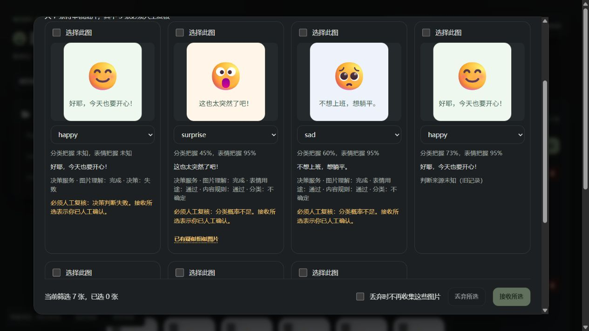

平台明确标记为表情的图片按配置抽样识别；普通图片或缺少平台分类的图片首次仅记录，重复出现后逐步提高识别概率。

采样概率、重复计数与识别间隔

普通图片或缺少平台分类的图片第二次出现时有 45% 的识别采样概率，之后逐次提高，第八次必定触发。同一发送者在不同消息中重复发送也会计数；连续 7 天未出现的记录会过期。单条消息最多处理的图片数可设置为 1–10 张，默认 1 张；同一来源最短识别间隔限制的是不同消息的入队时间，不影响重复次数记录。

自动收集默认关闭，识图需要调用视觉模型。开启后默认启用人工审核，可在管理页统一处理候选图片：

1. 进入**表情包管理**，切换到收集目标包。
2. 有待审核图片时，选包框右侧显示**待审核表情**按钮，点击查看图片、建议分类和两项置信度。
3. 默认按分类置信度从高到低排列，低把握度排在后面；可筛选分类、调整排序和修改接收分类，然后接收选中的图片。
4. 不需要的图片可以丢弃；勾选“不再收集”后，相同内容不会再次进入该包的候选列表。

关闭人工审核后，新收集的合格图片自动入包，强制复核及已有待审核图片仍需处理。启用语义选图后，默认在入包时自动增量生成向量；可在“自动收集 → 审核与入包”关闭“自动收集后生成向量”，改用管理页的“增量处理”。符合当前语义描述标准且接收分类未改变的视觉合并结果可直接复用描述；决策路径的独立图片理解先保存为描述草稿，需完成语义化后再建立向量。

## ⚠️ 兼容性

需要 **AstrBot 4.17.0 或更新版本**。

部分微信 4.x 接入中，JPG/PNG 可能显示为普通图片而非表情气泡，可尝试开启**设置中心 → 表情发送 → 静态图转 GIF 发送**。该选项默认关闭，仅在发送时转换，不修改图库原文件；其他平台通常无需开启。

其他插件自行请求模型或发送消息时，可通过本插件的公开接口接入表情处理。接口说明与示例见 [开发指南 → 插件联动接口](DEVELOPMENT.md#插件联动接口)，流式处理方式与边界见 [解析与消息发送](DEVELOPMENT.md#解析与消息发送)。

## 📝 使用指令

当前大部分功能都可以通过 AstrBot WebUI 管理界面操作，无需使用指令。以下为指令列表，供 CLI 用户参考：

| 指令                                   | 描述                                                |
| -------------------------------------- | --------------------------------------------------- |
| `/表情管理 查看图库`                   | 📚 列出所有可用表情类别                             |
| `/表情管理 添加分类 [类别名称] [描述]` | ➕ 创建新的表情包分类，可只输入名称后按提示补充描述 |
| `/表情管理 添加表情 [类别]`            | ➕ 通过聊天上传表情到指定类别                       |
| `/表情管理 恢复默认表情包`             | ♻️ 从官方仓库一键安装首个官方表情包并设为默认       |
| `/表情管理 清空指定类型 [类别]`        | ⚠️ 清空指定类别中的表情包，保留类型本身             |
| `/表情管理 清空全部`                   | ⚠️ 清空全部表情包，保留所有类型和描述配置           |
| `/表情管理 删除类型本身 [类别]`        | ⚠️ 删除指定类型及其描述配置                         |
| `/表情管理 同步状态`                   | 🔄 检查同步状态                                     |
| `/表情管理 同步到云端`                 | ☁️ 将本地表情同步到云端                             |
| `/表情管理 从云端同步`                 | ⬇️ 从云端同步表情到本地                             |
| `/表情管理 覆盖到云端`                 | ⚠️ 让云端与本地完全一致                             |
| `/表情管理 从云端覆盖`                 | ⚠️ 让本地与云端完全一致                             |

## 📜 更新日志

当前版本：v5.2.11

- 自动配图概率适用于分类、语义、纯表情标记与流式回复，支持 0–100%；主动 `send_meme` 工具由独立开关控制，不受该概率和自动配图数量上限限制。
- Tool 模式支持可选的独立概率触发，默认关闭；开启后命中轮次尝试一次检索，仍由主模型决定是否从候选中选图。
- 重复钩子、工具循环与重试复用门控结果，保留工具权限和其他工具；检索失败不阻断正常文字回复。

升级后请重载插件并刷新管理页面。Tool 概率触发开启后，命中轮次可能增加一次当前主模型的前置请求。

完整版本记录请查看 [CHANGELOG.md](CHANGELOG.md)。

## ✨ Star

感谢每一位使用、反馈、分享表情包和贡献代码的朋友。如果这个插件对你有帮助，欢迎点一个 Star。

分享，让你我走到了今天。

## 📄 许可证

本项目基于 MIT 许可证开源。
